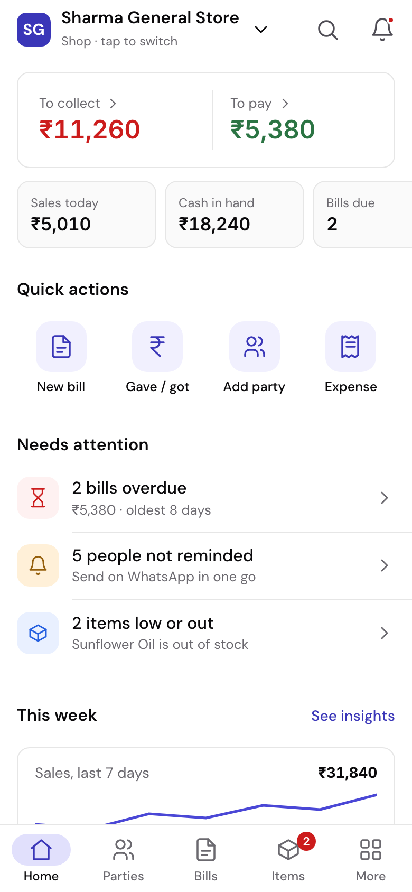
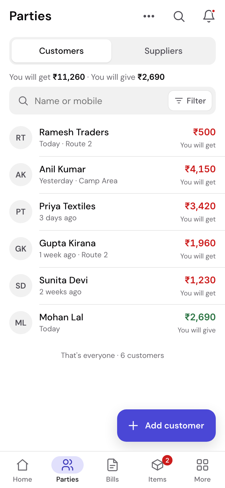
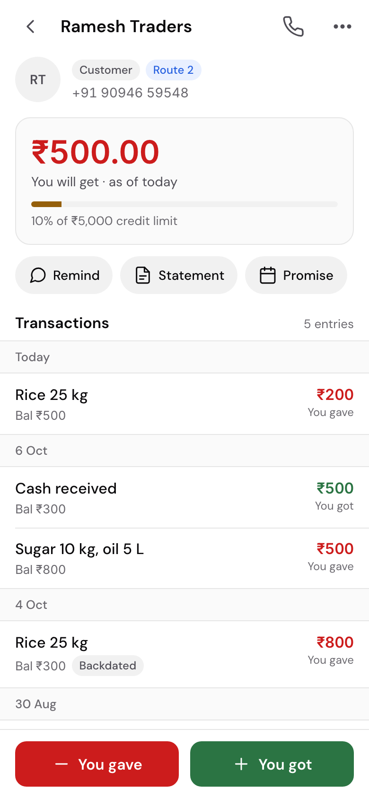
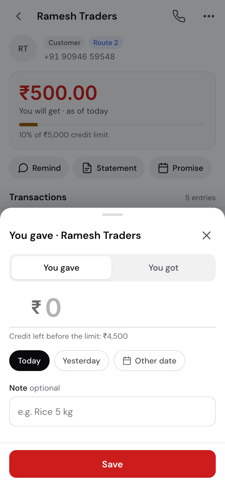
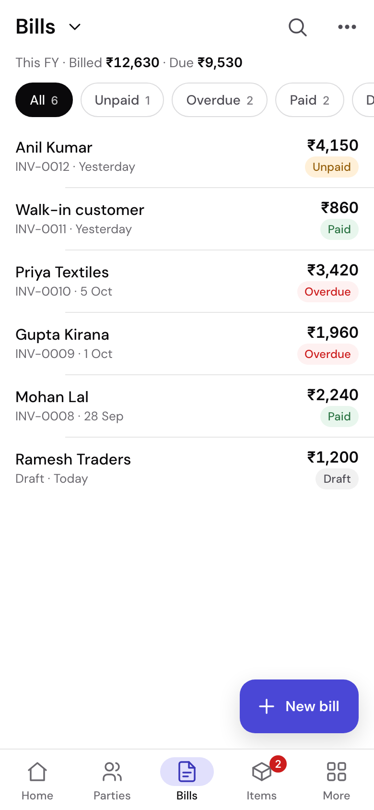
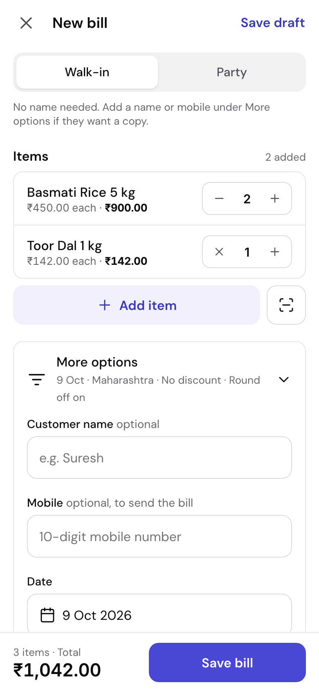
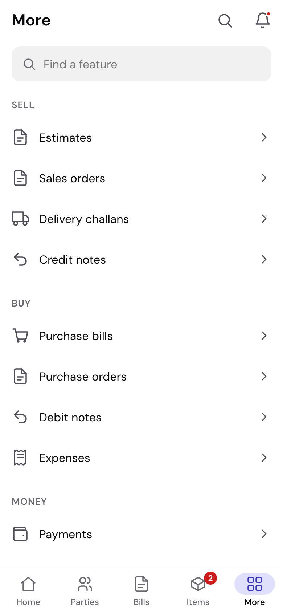
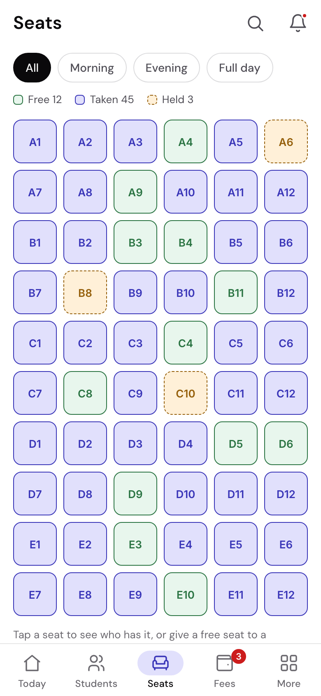

# Mobile-first redesign — proposal

**Status: proposal, awaiting the owner's go-ahead. No app code has changed.**
9 Oct 2026, against `dev` at `fae0fbcd`.

## The finding in one paragraph

The phone experience is the desktop with the sidebar folded into a ☰ drawer
and the page toolbars shrunk into rows of unlabelled icon squares. There is no
mobile navigation at all — the data for a bottom bar has existed in every app
manifest since Sprint 1 and nothing renders it. Primary actions sit at the top
of the screen, forms show every field at once (a new bill is 1,393 px tall with
one empty line), and the header truncates the business name to "Sharm…".

## The proposal in one paragraph

A **bottom navigation bar per app** (Shop: Home · Parties · Bills · Items ·
More), built from the manifests that already exist; a **More** tab that holds
every other destination in words; **one primary action per screen at the
bottom** (FAB on lists, a docked red/green You gave / You got on the khata, a
docked total + Save on forms); **⋯ sheets with labels** instead of icon rows;
**one Filter button** instead of rows of dropdowns; and **forms that fold
optional fields behind a one-line summary**. Every desktop feature keeps a
place. Desktop at ≥ 1024 px is untouched and a byte-for-byte screenshot check
proves it on every change.

## Try it

Open [`prototype/index.html`](prototype/index.html) in a browser (it is one
self-contained file). On a laptop it shows a phone with controls on the left
(app, screen state, theme, guided journeys) and the reasoning for each screen
on the right. On a phone it fills the screen.

| | | | |
|---|---|---|---|
|  |  |  |  |
| Home | Parties | Khata | You gave |
|  |  |  |  |
| Bills | New bill | More | Library seats |

Today's screens for comparison are in [`audit/`](audit/).

## Documents

1. [Audit of the current mobile experience](01-audit.md) — 20 findings, each with a screenshot or a file
2. [Research: competitors and guidelines](02-research.md) — what Khatabook, Vyapar, Zoho and the platform guidelines do, and which patterns fit here
3. [Information architecture and navigation](03-navigation-and-ia.md) — tabs per app, where all 25 Shop destinations go, journey step counts
4. [Mobile design system](04-design-system.md) — tokens, type, spacing, components, states, accessibility
5. [Screen-by-screen recommendations](05-screens.md)
6. [Implementation plan and validation](06-implementation-plan.md) — desktop isolation, phases, user-task script, testing checklist

## What needs a decision

1. **The navigation model**: bottom bar + More, with Shop tabs Home · Parties ·
   Bills · Items.
2. **Three recorded 23 Sep decisions change on phones only** (06 §1): header
   actions become a ⋯ sheet, the khata's gave/got pair docks permanently, and
   the FAB is placed.
3. **You gave red / You got green** instead of indigo / grey.

Defaults if unanswered: the proposal as drawn, desktop untouched, built in the
seven phases of 06 §3.
